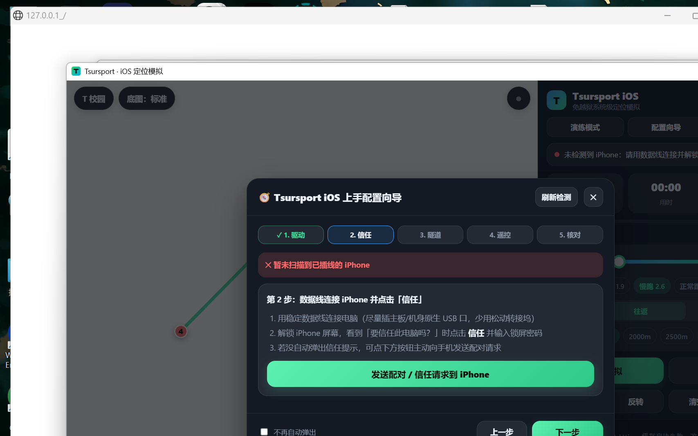

# Tsursport iOS

> 免越狱的 iPhone 定位模拟控制台 —— 用电脑通过苹果调试通道注入位置，手机端只负责发指令。

<p align="center">
  
</p>

<p align="center">
  
  
  
  
</p>

---

## 这是什么

iOS 不像 Android 那样给普通 App 开放「模拟位置」接口，所以**装一个 App 改定位在 iOS 上不成立**。

本项目走的是另一条路：**电脑通过数据线，用苹果自己的调试通道（DeveloperDiskImage / DTX）直接改写手机的定位服务**——
不越狱、不签名、不装 App，而且系统不会把它标记为「模拟位置」。

Tsursport iOS 就是这套东西的图形界面：选路线、定配速、开始/暂停、一键恢复真实定位。

配套的安卓版在 [Tsursport](https://github.com/LinYiZhiYao/Tsursport)。

## 功能

| 功能 | 说明 |
|---|---|
| 🧭 地图画路线 | 在高德底图上点选折线，支持撤销/清空，保存在本地 |
| ⏱️ 配速控制 | 0.8–15 m/s 无级调速，实时换算配速 |
| ▶️ 开始 / 暂停 / 继续 | 运行中可随时暂停，继续时从里程断点接着走 |
| 🔌 设备向导 | 五步检测：驱动 → 信任 → 隧道 → 遥控 → 核对 |
| 🎭 演练模式 | 没有 iPhone 也能把完整流程跑一遍 |
| 📱 手机遥控页 | 同一 Wi-Fi 下用手机浏览器当第二块屏幕 |
| 🔄 一键恢复 | 停止时调用 `simulate-location clear`，手机回到真实定位 |

## 安装

### 方式一：免安装压缩包（119 KB，推荐）

1. 从 [Releases](../../releases) 下载 `Tsursport-iOS-1.0.0.zip`
2. **解压整个文件夹**（不要只拖出 exe）
3. 双击 `Tsursport-iOS.exe`

启动器只有 7 KB，作用是用本机 Python 拉起 `tsursport_gui.py`。
它不解压、不写系统目录、不调用安装服务，因此不会遇到
「拒绝访问 / Error 5 / 1601 / 找不到临时目录」这类问题。

> 前提：本机已安装 **Python 3.9+**（安装时勾选 `Add Python to PATH`）。

### 方式二：MSI 安装包（31 MB）

1. 下载 `Tsursport-iOS-1.0.0.msi`
2. 双击安装，文件由 Windows Installer 服务写入
3. 开始菜单 / 桌面出现 **Tsursport iOS**

已内置 Python 运行时与全部依赖，**不需要预装 Python**。
卸载走「设置 → 应用 → Tsursport iOS」。

### 方式三：winget（清单已提交，审核通过后可用）

```powershell
winget install LinYiZhiYao.Tsursport-iOS
```

无 SmartScreen 提示、无需手动解压。清单与提交流程见 [winget/README.md](winget/README.md)。
## 首次连接 iPhone

```
① 装驱动      winget install Apple.AppleMobileDeviceSupport
② 数据线连接   手机上点「信任此电脑」，输入锁屏密码
③ 开发者模式   设置 → 隐私与安全性 → 开发者模式 → 打开（会重启一次）
④ 回程序       点向导里的「刷新检测」，五步全绿即可
```

iOS 17 及以上必须走 RSD 隧道，程序会自动执行 `pymobiledevice3 remote start-tunnel`，
不需要手动敲命令。

## 使用流程

```
1. 打开程序 → 向导自动检测设备
2. 地图上点选路线（至少两个点）
3. 拖速度滑杆设定配速（2.6 m/s ≈ 6'25"/km）
4. 点「开始模拟」→ 手机定位开始沿路线移动
5. 跑完点「恢复真实定位」
```

没有 iPhone 时点 **「演练模式」**，界面与流程完全一致，只是不真的改定位。

## 工作原理

```
Tsursport GUI (WebView2 界面)
      │  本地 HTTP
      ▼
tsursport_pc.py  ── 路线引擎 / 配速 / 断点续跑
      │  subprocess
      ▼
pymobiledevice3
      ├─ remote start-tunnel        建立 RSD 隧道（iOS 17+）
      ├─ developer dvt simulate-location play route.gpx --speed X
      ├─ ... set -- LAT LON         单点定位
      └─ ... clear                  恢复真实定位
```

- 路线点用 **GCJ-02**（与高德地图一致），写 GPX 前转 **WGS-84**
- 暂停时冻结里程，继续时用 `slice_from()` 截取剩余折线重新播放
- 运行中调速会先冻结里程再按新速度续跑

## 项目结构

```
Tsursport-iOS/
├─ app/
│  ├─ tsursport_gui.py      图形界面 + 内嵌 HTTP 服务
│  ├─ tsursport_pc.py       核心：设备通信 / 路线引擎 / API
│  ├─ web/                  地图界面（Leaflet，本地加载）
│  └─ tsursport.ico
├─ launcher/
│  ├─ Launcher.cs           7 KB 原生启动器源码
│  └─ Tsursport-iOS.exe     编译产物（用本机 Python 拉起脚本）
├─ tsursport.iss            Inno Setup 打包脚本
├─ tsursport_offline.spec   PyInstaller 打包脚本（MSI 用）
├─ docs/screens/
├─ CHANGELOG.md
├─ LICENSE
└─ README.md
```

## 自己构建

```powershell
# 直接跑源码（需要 Python 3.9+ 与依赖）
pip install -U pymobiledevice3 pywebview
python app\tsursport_gui.py

# 编译 7 KB 启动器
csc /target:winexe /out:Tsursport-iOS.exe ^
    /r:System.Windows.Forms.dll /r:System.Drawing.dll launcher\Launcher.cs

# 打包自包含版本（可选，产物 70 MB）
python -m PyInstaller --noconfirm --clean tsursport_offline.spec
```

## 常见问题

**Q：每次打开都提示「Windows 已保护你的电脑」？**
A：文件带「来自 Internet」标记。右键 exe → 属性 → 勾选「解除锁定」，一次即可永久消除。

**Q：提示「未检测到 iPhone」？**
A：按顺序检查：数据线是否数据线（不是充电线）→ 手机是否点「信任」→ 是否装了 Apple 驱动 → 开发者模式是否开启。程序里的向导会指出卡在哪一步。

**Q：界面白屏 / 弹出一个空白浏览器窗口？**
A：多半是同时开了两个实例，争抢 WebView2 缓存目录。关掉所有窗口重开。程序也会自动清理残留的 `msedgewebview2` 进程。

**Q：改了定位，但目标 App 仍显示真实位置？**
A：少数 App 会自采 WiFi/基站做二次定位（如微信）。可以关掉 WiFi 只用移动数据试试；仍不行说明该 App 走了自己的定位 SDK。

**Q：拔掉数据线会怎样？**
A：定位立刻回到真实值。这是这套方案的固有限制——注入依赖持续连接。

## 能力边界

| 能做到 | 做不到 |
|---|---|
| 系统级定位（经纬度、精度、速度、航向）| 断开电脑后继续模拟 |
| 轨迹、配速、里程按设定推进 | 伪造步数 / 心率等传感器数据 |
| 连 iPhone 时无「模拟位置」标记 | 拦截 App 自采的 WiFi / 基站定位 |
| 随时一键恢复真实定位 | 越狱设备上可能被检测 |

## 许可

[MIT](LICENSE) © 林忆知遥

> 仅用于自有设备上的定位与运动数据调试、演示。iOS 端定位注入依赖苹果开发者调试接口，请在了解其影响的前提下使用。
